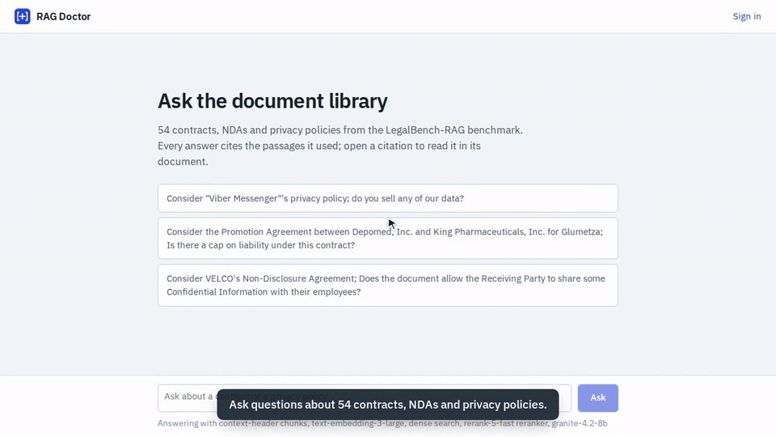
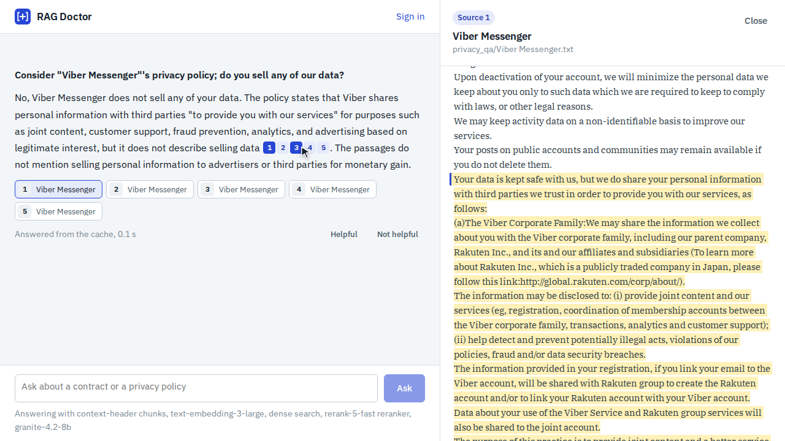
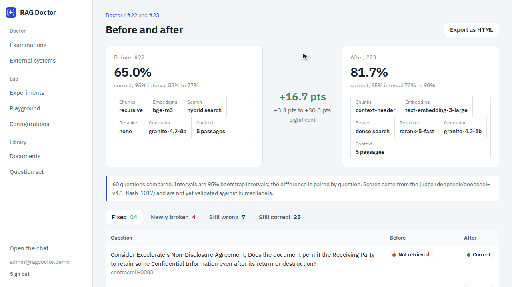
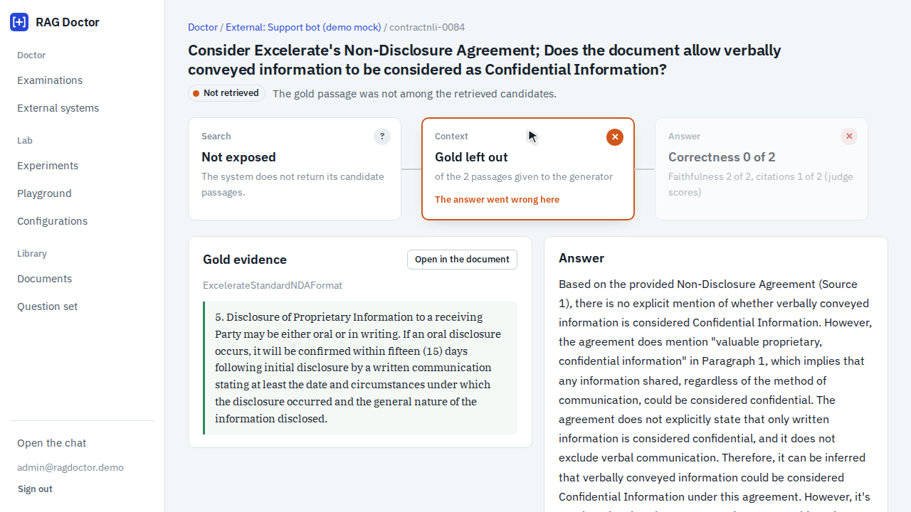
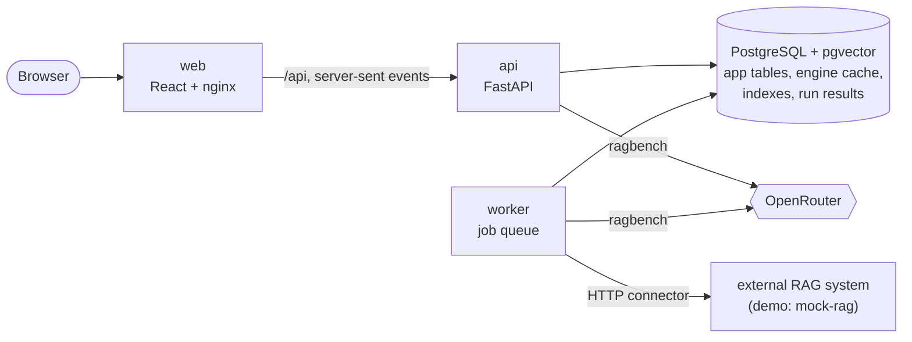

# RAG Doctor

Chat with your documents, then find out why the answers go wrong: RAG Doctor examines a
retrieval-augmented generation system question by question, measures the fix on your own corpus
and proves it with a before/after report. For teams that run RAG and need evidence, not hunches.

[](https://github.com/joaopaulopresa/rag-doctor/actions/workflows/ci.yml)
[](LICENSE)




## What it does

- **Answers questions with sources.** Every answer cites the passages it used; a citation opens
  the passage, highlighted in its document.
- **Locates each wrong answer.** On a gold question set, the doctor says where every failure
  happened: the evidence was never retrieved, was found but ranked out of the context, was in
  the context and ignored, or the answer claims what the context does not say.
- **Prescribes by measurement, not by rule of thumb.** For the failing stage it runs an
  experiment on your corpus and shows each candidate's gain over the current configuration; one
  click applies the winner to the live chat, and the old configuration stays in the history.
- **Proves the change.** A before/after report on the same questions lists what was fixed and
  what broke, with paired confidence intervals; it exports as a single HTML file.
- **Audits other systems.** Point it at any RAG endpoint over HTTP, say where the answer and the
  passages are in the reply, and get the same diagnosis without access to its code.

## Quick start

You need Docker and an [OpenRouter](https://openrouter.ai) API key.

```bash
git clone https://github.com/joaopaulopresa/rag-doctor.git && cd rag-doctor
cp .env.example .env            # then put your key in OPENROUTER_API_KEY
docker compose up -d
```

Open <http://localhost:5310>. The chat is open to everyone; the lab and the doctor are at
<http://localhost:5310/admin> (demo login `admin@ragdoctor.demo`, password `doctor-admin`).

On first start the app downloads the demo corpus and indexes it. From a fresh clone this took
91 seconds and $0.05 of OpenRouter credit on a machine that already had the Docker base images.
Every model call is cached in PostgreSQL, so repeating anything costs nothing.

Ports and the Compose subnet can be changed in `.env` (`WEB_PORT`, `API_PORT`, `DB_PORT`,
`MOCK_RAG_PORT`, `SUBNET`).

## Demos

All three are recorded by Playwright scripts in `e2e/demo/` that drive the real application;
the captions quote numbers read from the page.

| Chat (40 s) | Doctor (68 s) | External audit (36 s) |
|---|---|---|
| [](docs/media/chat.mp4) | [](docs/media/doctor.mp4) | [](docs/media/external.mp4) |
| Three questions; each citation opens its passage. | Examine a first build, open a "not retrieved" case, run the prescribed experiment, apply the winner, read the before/after. | Connect a deliberately weak RAG service and diagnose it. |

### What the doctor demo measured

On the demo corpus, starting from a typical first build:

| | First build | After the prescribed fix |
|---|---|---|
| Chunks | recursive, 512 tokens | context header, 512 tokens |
| Embedding | bge-m3 | text-embedding-3-large |
| Search | hybrid | dense |
| Reranker | none | Cohere rerank-5-fast |
| Generator | Granite 4.2 8B | Granite 4.2 8B |
| Correct, 60 questions | **65.0%** (95% interval 53–77%) | **81.7%** (95% interval 72–90%) |

The difference is +16.7 points with a paired 95% interval of +3.3 to +30.0: 14 questions fixed,
4 newly broken. Hybrid search ranked below dense search on this corpus, so the doctor did not
recommend it; on another corpus the measurement may differ, which is the point. The weak external
service answered 27% of 30 questions correctly, and 22 of the 30 failed because the evidence was
not among the two passages it gave its model.

"Correct" means the judge (DeepSeek v4.1 flash) gave full correctness and the main claim is
supported by the passages. These are judge scores; the judge has not yet been validated against
human labels.

## How the doctor decides

For each question it compares the gold evidence with what the system retrieved, then has the
judge score the answer. The first stage that failed is blamed:

| Outcome | Meaning | Candidate fixes it measures |
|---|---|---|
| Correct | the answer matches the gold evidence and is supported | none |
| Not retrieved | the gold passage was not among the candidates | chunking, embedding model, search mode |
| Retrieved, ranked low | it was found but fell out of the context | a reranker, more passages in the context |
| In context, ignored | it was given to the generator and the answer missed it | generator model, prompt |
| Unsupported | the answer's main claim is not in the context | generator model, prompt, citation check |
| Wrong gold | a reviewer marked the question itself as bad | fix the question set |

For an external system that returns no candidates, "not retrieved" cannot be told apart from
"ranked low", and the report says so.

## Architecture



The engine is [ragbench](https://github.com/joaopaulopresa/rag-bench), installed as a pinned
dependency: chunkers, PostgreSQL search, the pipeline, retrieval metrics, the LLM judge, the
response cache and the three-stage experiment runner all come from there. This repository adds
the application around it: the chat, the library and question set, the lab, the doctor's
decision rule and prescriptions, the before/after comparison and the external connector.

Long work (indexing, experiments, examinations) runs in a worker that claims jobs from a
PostgreSQL table with `FOR UPDATE SKIP LOCKED`; the screens follow progress over server-sent
events. One database holds the application's tables and, in a separate schema, the engine's
cache, indexes and run results.

## Tech stack

Python 3.13, FastAPI, SQLAlchemy and Alembic, ragbench, PostgreSQL 16 with pgvector, React 19
with TypeScript and Vite, nginx, Docker Compose, pytest, Vitest, Playwright, GitHub Actions.
Models through OpenRouter: Granite 4.2 8B answers in the chat, DeepSeek v4.1 flash judges, and
Llama 3.1 8B drafts candidate questions and plays the weak external system.

## Testing

```bash
docker compose up -d db && (cd api && uv run pytest)   # 60 tests, no model is called
npm --prefix web test                                   # 10 component tests
docker compose up -d && npx playwright test --project=e2e   # 9 browser tests on the stack
bash e2e/demo/record.sh                                 # records the three demo videos
```

- **API:** the doctor's decision rule, evidence matching by position and by text, the
  prescription plans, the before/after statistics, the connector mapping; on PostgreSQL:
  sign-in and roles, question import validation, two workers claiming jobs, marking a question
  as wrong gold, the comparison endpoint and its HTML report.
- **Web:** citation parsing, the outcome strip, the pipeline trace.
- **End to end:** chat with citations, feedback to the review queue, sign-in, the doctor on a
  sample, document upload until the chat cites it, the playground, restoring a configuration,
  connecting an external system.

## Project structure

```
api/        FastAPI app, worker, doctor, connectors, migrations, tests
web/        React app served by nginx
mock_rag/   the deliberately weak external RAG service used in the demo
e2e/        Playwright browser tests and the demo recordings
docs/media/ demo videos, hero animation and screenshots
```

## Limits

- The judge is an LLM and has not been validated against human labels; every score here is a
  judge score.
- Samples are small (60 questions in the doctor demo), so intervals are wide.
- Answers are not streamed token by token: the passages arrive first, then the whole answer.
- The before/after report exports as HTML; PDF export is not implemented (print to PDF works).
- The demo videos replay cached model calls, so the timings in them are not real latency; the
  chat says "Answered from the cache" when that happens.
- The external connector speaks JSON over HTTP with static headers; passages without positions
  are matched to the gold evidence by text.
- Sign-in is demo-grade: two seeded accounts, no password reset, no rate limiting.
- Not tested: PDF upload (text upload is tested end to end), scanned PDFs (they need OCR),
  corpora much larger than the demo, many concurrent users, and the Qwen reranker in experiments
  (left out because it costs about ten times more than Cohere).

## Licence and credits

MIT, see [LICENSE](LICENSE).

- Demo corpus: [LegalBench-RAG](https://huggingface.co/datasets/awinml/legalbench-rag), the
  "mini" sample of three sources: PrivacyQA (MIT), ContractNLI (CC BY 4.0) and CUAD
  (CC BY 4.0); queries under MIT. MAUD is left out because its licence is not stated upstream.
- Fonts: IBM Plex Sans and IBM Plex Serif (SIL Open Font License).
- Models are reached through OpenRouter and remain under their providers' terms.
